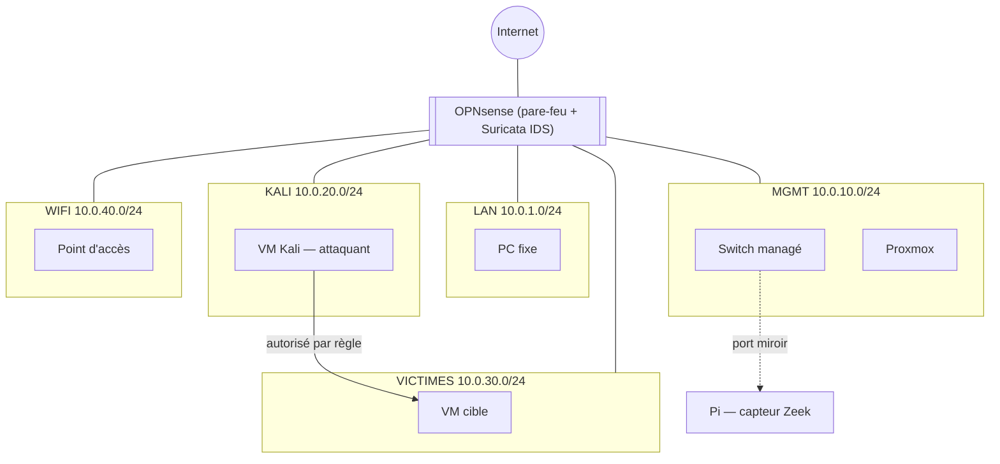
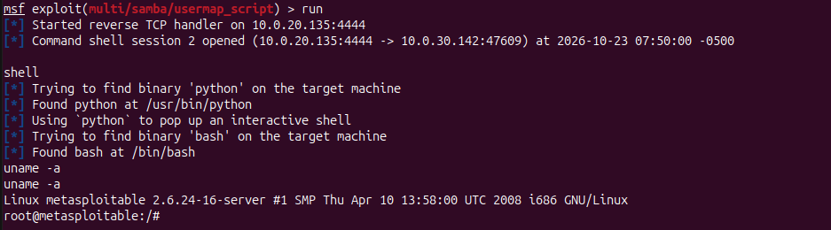
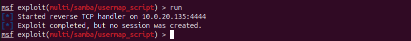

# Homelab SOC : segmentation, détection et durcissement Samba

## Contexte

Objectif du lab : apprendre les étapes d'une compromission et sa détection. Trois rôles : une VM Kali (attaquant), une VM cible vulnérable (Metasploitable 2), et un capteur Zeek en écoute passive sur un port miroir, avec Suricata sur le pare-feu.

## Architecture

Chaque segment correspond à un VLAN séparé. Les paquets sont routés par le pare-feu. Sur la machine proxmox (hyperviseur de type 1) il y a deux VM (Kali pour l'attaque et Metasploitable 2 à durcissir). Pour que le traffic soit visible les VM ne se parlent qu'en traversant le switch (miroir) et le pare-feu (Suricata). Pour des raisons de sécurité, KALI et VICTIMES n'ont aucun accès vers LAN/MGMT/WIFI qui possèdent des interfaces de management.

## Le Dispositif

- **IDS passif sur un port miroir** : le capteur ne voit que ce qui traverse le port en mirroir, et ne peut rien bloquer lui-même. En contrepartie, une panne du capteur ne coupe jamais le trafic réel.
- **Deux capteurs complémentaires** : Suricata sur le pare-feu OPNsense voit le trafic nord-sud (ce qui sort et entre du réseau interne) ainsi que l'inter-VLAN (ce qui traverse le switch). Zeek placé sur le port miroir du switch peut aussi voir l'est-ouest du segment.
- **Segmentation par VLAN plutôt que même sous-réseau** : chaque segment a sa propre politique de pare-feu : un VLAN par rôle (attaquant, cible, administration, confiance) plutôt que par appareil.

## L'objet d'Etude:

Nous voila sur la machine proxmox: la VM Kali sert à attaquer et tester les vulnérabilités de la machine test. La VM MS2 (Metasploit 2) est une machine vulnérable qui devra resister au test d'intrusion avec le durcissement de son système.  

Un scan `nmap -sS -sV -p1-65535` de Kali vers la cible donne deux lectures très différentes du même trafic :

coté IDS: Suricata déclenche 8 alertes (« ET SCAN Possible Nmap User-Agent Observed »), uniquement sur l'interface VICTIMES.

coté Logs: Zeek créer 1085 lignes : 980 REJ (ports fermés), 69 SF (connexions complètes), 28 RSTO, 4 RSTR, 3 OTH, 1 S2

Suricata ne signale que ce que ses règles décrivent (ici, une signature de scan nmap sur un service web).
Zeek enregistre toute connexion, qu'elle corresponde ou non à une règle connue.

Suite au scan nmap, on repère un service Samba vulnérable à une injection de commande ([avis éditeur Samba, CVE-2007-2447](https://www.samba.org/samba/security/CVE-2007-2447.html)) : la directive `username map script` passe l'entrée utilisateur à `/bin/sh` sans contrôler les inputs. 

## Durcissement : Samba 3.0.20 (CVE-2007-2447)

Pour ajouter une dimension réaliste au lab: un rôle fictif donné à la machine. Ici on s'imagine sur serveur de fichiers de PME. Le focus sera fait sur une petite équipe comptabilité de 3 personnes (Julie,David,Martin) dont le serveur est vulnerable. Le but sera de durcir le serveur sans casser les services déjà en place.

Mesures appliquées:
1. Contournement de la faille : On retire le fichier username map script qui permet à l'attaque de se connecter sans autentification. Cette mesure se fera dans l'attente un patch correctif.

   La mesure n°1 corrige l'injection de commande sans authentification depuis un attaquant externe. Cependant n'importe quel attaquant déjà connecté au réseau peut encore atteindre le partage, sans distinction de compte ni de droit (pas d'authentification exigée, pas de cloisonnement par utilisateur ou par groupe). Les mesures suivantes permettent de limiter ce risque.

2. Comptes nominatifs pour les trois employés, sans mot de passe Unix (accès SMB uniquement). Les comptes n'ayant pas de sessions Unix actives, cette mesure augmente peu la surface d'attaque.
3. Création d'un groupe "comptabilité" avec droits setgid (2770) sur le dossier partagé. L'accès et l'écriture se font à travers le groupe "comptabilité" ; les utilisateurs "autres" ne peuvent ni accéder ni écrire dans le dossier de partage.
4. Suppression des partages par défaut inutiles au rôle. Chaque fonctionnalité du serveur de partage doit correspondre à un besoin métier ; les fonctionnalités liées à l'écriture des invités et à l'utilisation d'une imprimante sont donc supprimées (on a considéré ici que la PME possédait déjà un réseau d'impression).
5. Blocage de l'énumération anonyme (`restrict anonymous = 2`). L'accès anonyme hérité des anciennes versions de Windows permettait de faire une énumération des utilisateurs à cibler.
6. Suppression de l'affichage de la version de Samba (l'attaquant pouvait déterminer la version via une requête anonyme).
7. Nettoyage de la base de comptes Samba (35 comptes système retirés, seuls les 3 comptes « humains » sont gardés).
8. Confinement du partage : liens symboliques désactivés, l'attaquant ne peut plus s'échapper du dossier partagé avec un symlink pointant vers la racine du serveur de fichiers.
9. Accès restreint par IP source : seules les machines ayant un besoin métier prédéfini peuvent se connecter au serveur de partage.
10. Politique de mots de passe (longueur, verrouillage) : le système de verrouillage (`bad lockout attempt`) est connu pour être défectueux sur cette version. Le choix le plus logique est de se tourner vers les logs pour surveiller les tentatives de connexion.

## Conclusion :
Après des tests de connexions les utilisateurs ont toujours accès à leur serveur de fichiers. La faille est toujours présente mais n'est plus exploitable: Mission Accomplie

