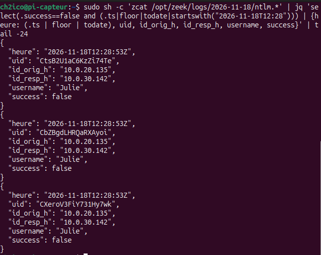
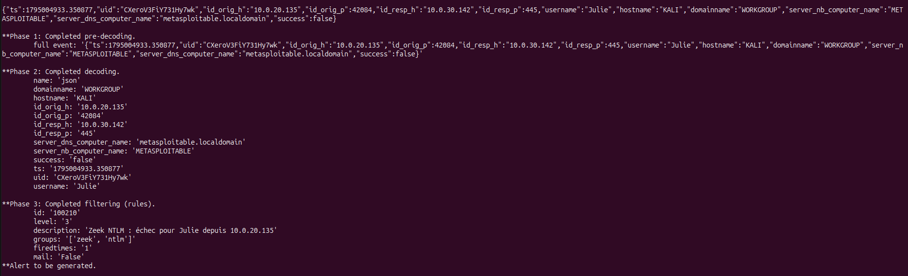
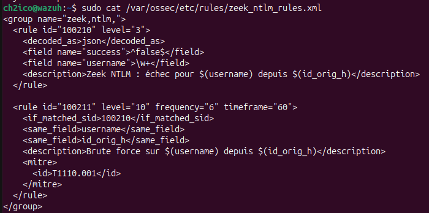
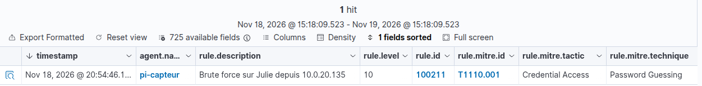

# Homelab SOC : détecter un brute force NTLM avec Wazuh

**Suite de :** [Homelab SOC : segmentation, détection et durcissement Samba](../)<br>
**Outils :** Wazuh 4.14, Zeek, Kali, Proxmox

## Contexte

Je reprends le contexte de la pièce précédente : le serveur de fichiers d'une petite PME et de son service comptabilité.

Après avoir durci le serveur SMB (Samba) de ma VM vulnérable (Metasploitable 2), je me suis rendu compte que le verrouillage de compte ne fonctionnait pas. Le compteur « Bad password count » restait à 0 malgré les échecs de connexion. Après recherche, ce défaut de cette version de Samba était connu. Il fallait donc surveiller les tentatives de connexion avec un SIEM, pour détecter un brute force.

L'objectif est donc de mettre en place un SIEM qui collecte les logs de mon capteur réseau Zeek (Raspberry Pi 4), puis d'écrire et tester une règle qui remonte une alerte quand le serveur Samba subit un brute force.

## Le dispositif

Wazuh et Zeek sont deux outils complexes. Mon sous-objectif a été de garder une architecture et une gestion simples.

- **Wazuh tout-en-un** (manager, indexer, tableau de bord) dans une seule VM : tout est centralisé, pas de cluster à gérer.
- **Zeek** sur un Raspberry Pi branché sur le port miroir du switch. Zeek analyse les paquets copiés et écrit ce qu'il observe dans ses fichiers de logs. Un agent Wazuh installé sur le Raspberry Pi lit ces logs et les envoie au manager.

## De Zeek à Wazuh : le trajet d'un échec NTLM

```
Zeek (Pi sur port miroir) -> agent Wazuh -> manager (VM Wazuh) : décodeur, puis règles -> alerts.json -> Filebeat -> indexer -> tableau de bord
```

### 1. Zeek voit l'authentification

Comment le Pi voit-il le trafic entre deux VM ? La VM Kali (attaquant, VLAN 20) et la VM Metasploitable 2 (cible, VLAN 30) tournent toutes les deux sur Proxmox. Le Pi est branché sur un port miroir du switch (port mirroring) : le switch lui envoie une copie de tout le trafic qui passe entre les deux VM. Une fois le trafic copié, Zeek le voit et écrit une ligne par événement, dans un fichier de log par protocole : `ntlm.log` pour NTLM, `http.log` pour HTTP, etc.

Voici trois échecs de connexion, lus avec `jq` (heure convertie en format lisible) :



Le mot de passe n'apparaît jamais, car NTLM ne fait pas circuler le mot de passe sur le réseau. En revanche, on voit le compte (`username`), la machine source (`id_orig_h`, son adresse IP) et le résultat de l'authentification (`success`).

### 2. Des logs en JSON

Par défaut, Zeek écrit ses logs en TSV : du texte en colonnes séparées par des tabulations, un peu comme un CSV ou une feuille Excel. Wazuh reçoit ces lignes mais ne sait pas les découper sans l'ajout d'un décodeur TSV. Pour rester simple, j'ai suivi l'approche du blog Wazuh sur l'intégration de Zeek : passer Zeek en JSON avec le script `@load policy/tuning/json-logs`. En JSON, chaque valeur arrive avec son nom (Key : value), et Wazuh possède déjà un décodeur JSON qui découpe la ligne en champs automatiquement.

### 3. L'agent Wazuh sur le Raspberry Pi lit et envoie les fichiers

Une fois l'agent Wazuh installé sur le Raspberry Pi, qui joue le rôle de capteur réseau, il faut lui désigner les fichiers à lire et à envoyer dans sa configuration (ici le fichier Zeek `ntlm.log`) :

```xml
<localfile>
  <log_format>json</log_format>
  <location>/opt/zeek/logs/current/ntlm.log</location>
</localfile>
```

L'agent envoie chaque nouvelle ligne au manager sur le port 1514 (Agent connection service). Pour garder le tout secret, ces échanges sont chiffrés, après une authentification de l'agent sur le port 1515 (Agent enrollment service).

### 4. Le manager décode, puis applique les règles

L'outil `wazuh-logtest` montre ce que le manager fait d'une ligne : le décodeur JSON la découpe en champs (phase 2), puis le manager compare ces champs aux règles. Si une règle correspond, une alerte est créée (phase 3). Sinon, l'événement est jeté sans alerte.



### 5. Jusqu'au tableau de bord

Le manager écrit ensuite l'alerte dans le fichier `alerts.json`, Filebeat la transporte jusqu'à l'indexer, et le tableau de bord lit l'indexer pour afficher l'alerte.

Il peut cependant y avoir des conflits entre ces composants. Lors de mes premiers tests, les alertes Zeek étaient bien dans `alerts.json`, mais rien n'apparaissait dans le tableau de bord. En remontant la chaîne, j'ai trouvé dans le journal de Filebeat des milliers de refus de l'indexer (« Cannot index event », erreur 400 sur le champ `data.id`). C'est une erreur connue, signalée par d'autres utilisateurs de Zeek avec Wazuh. Wazuh range les champs décodés sous `data.`. Le champ Zeek `id.orig_h` devient donc `data.id.orig_h`, et `data.id` devient un objet, alors que l'indexer attend du texte dans ce champ, ce qui casse la chaîne. J'ai donc changé le séparateur de Zeek : `id.orig_h` devient `id_orig_h`. Après ce changement, les alertes Zeek apparaissent dans le tableau de bord.

## La détection

Revenons à Metasploitable 2 et à son verrouillage de compte défectueux sur le serveur SMB Samba.

Depuis la VM Kali (attaquant), je lance 6 fois la commande `smbclient -L //10.0.30.142 -U Julie%mauvais`. Résultat : les 6 échecs arrivent dans `ntlm.log`, en 5,27 s.

**Les règles :**

La rédaction des règles (structure, numéros, niveaux d'alerte...) suit une syntaxe précise définie par Wazuh. La documentation utilisée est en bas de page.

Comment fonctionnent les règles ? Après le décodeur JSON, les champs sont comparés aux conditions des règles. Une règle peut aussi s'appuyer sur une autre : elle ne lit plus le log, elle compte combien de fois l'autre règle s'est déclenchée, dans une durée donnée et avec des champs identiques. Dans notre cas, il y a une règle de base (100210) et une règle de corrélation qui s'appuie sur elle (100211).

- 100210 (niveau 3), règle de base : détecte un échec NTLM, c'est-à-dire `success = false` et un nom de compte (`username`).
- 100211 (niveau 10), règle de corrélation : se déclenche quand 100210 s'est déclenchée 6 fois en 60 secondes, pour le même compte et la même adresse source. La fenêtre de 60 s vise à attraper aussi un attaquant moins rapide, mais peut créer des faux positifs.



**Les tests :**
- Positif : le brute force depuis Kali déclenche bien l'alerte 100211.
- Négatif : après le déclenchement de 100211, un échec espacé de plus de 60 s ne déclenche que 100210 (niveau 3), pas de 100211.



Grâce aux éléments de l'attaque (un compte, des échecs répétés), j'ai associé la règle 100211 à la technique MITRE ATT&CK T1110.001 Password Guessing. Les infos remontent bien dans le tableau de bord, ce qui simplifie la lecture de l'attaque pour l'analyste.

## Limites

- Password spraying (un essai par compte) : non détecté.
- Attaquant lent : sous 6 essais par minute, il passe sous le seuil.
- Nom de compte vide (connexion anonyme) : non couvert.
- Faux positifs : un script ou un service avec un mot de passe périmé déclenche la règle. Ce n'est pas une attaque, mais c'est un vrai problème à signaler.
- Attaque continue : le compteur repart à zéro après chaque alerte, donc 600 essais donnent 100 alertes.

## Ce que j'ai appris

- Les règles Wazuh suivent une syntaxe stricte : il faut s'appuyer sur la documentation.
- Le parsing est complexe : faire passer les champs d'un outil à l'autre (Zeek, puis Wazuh, puis l'indexer) demande de vérifier les noms et les types de champs à chaque étape.
- Pour retrouver un événement, j'utilise l'identifiant de connexion de Zeek (`uid`), présent dans les logs Zeek comme dans l'alerte Wazuh.

## Références

- Wazuh (blog), Network security monitoring with Wazuh and Zeek (passage de Zeek en JSON, lecture par l'agent) : https://wazuh.com/blog/network-security-monitoring-with-wazuh-and-zeek/
- Wazuh, Rules Syntax (options `if_matched_sid`, `frequency`, `timeframe`, `same_field` de la règle 100211) : https://documentation.wazuh.com/current/user-manual/ruleset/ruleset-xml-syntax/rules.html
- Wazuh, Rules classification (niveau 10 : erreurs multiples d'un utilisateur, comme plusieurs mauvais mots de passe) : https://documentation.wazuh.com/current/user-manual/ruleset/rules/rules-classification.html
