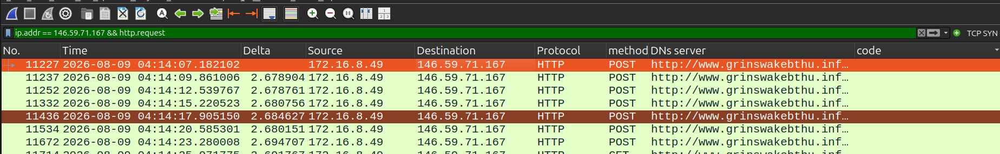
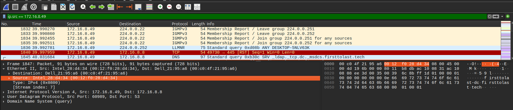
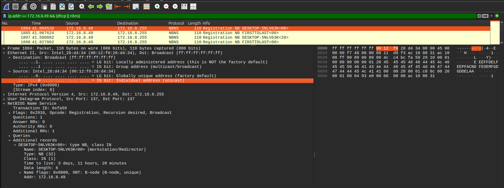
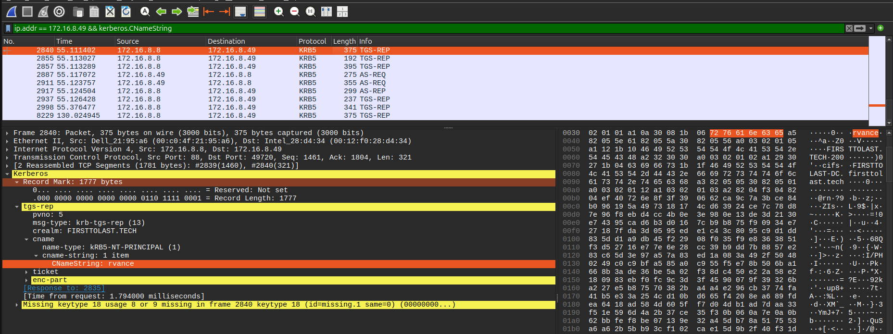
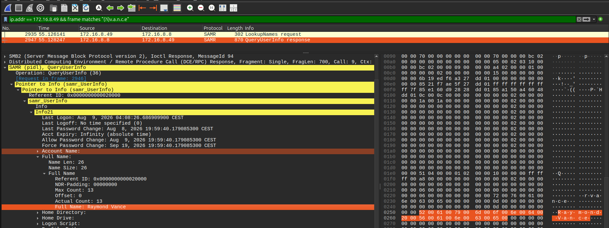
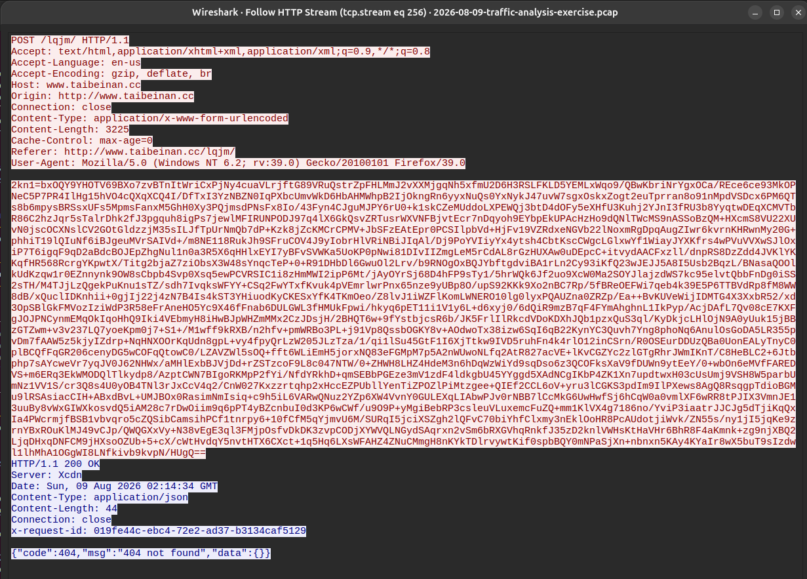

# FormBook / XLoader : identifier un poste infecté à partir d'alertes IDS

**Exercice :** [Malware-Traffic-Analysis.net, 2026-08-09 « First to Last »](https://www.malware-traffic-analysis.net/2026/08/09/index.html)
**Outils :** Wireshark, CyberChef, VirusTotal

> Les indicateurs sont neutralisés (`[.]`). Les heures sont en UTC ; mes captures Wireshark affichent l'heure locale (UTC+2).

## Contexte

Je remplace un analyste SOC. L'IDS remonte des alertes `ET MALWARE FormBook CnC Checkin (GET)` à partir de 02:13 UTC, vers plusieurs IP externes. Avec la capture réseau, je dois retrouver le poste infecté et son utilisateur.

Réseau : 172.16.8[.]0/24, domaine `firsttolast[.]tech`. L'énoncé donne le contrôleur de domaine en 172.16.8[.]2, mais dans le trafic, c'est 172.16.8[.]8 qui répond (DNS, Kerberos, SMB).

## Poste infecté

| Élément | Réponse | Filtre Wireshark |
| --- | --- | --- |
| IP | 172.16.8[.]49 | `ip.addr == 146.59.71.167 && http.request` (qui parle à l'IP de l'alerte) |
| MAC | 00:12:f0:28:d4:34 | `ip.src == 172.16.8.49`, couche Ethernet |
| Nom d'hôte | DESKTOP-5NLV63K | `ip.addr == 172.16.8.49 && nbns` |
| Compte | rvance | `ip.addr == 172.16.8.49 && kerberos.CNameString` |
| Nom complet | Raymond Vance | `ip.addr == 172.16.8.49 && samr` (réponse `QueryUserInfo`) |

## Comportement du malware

- **Vecteur d'infection non visible** : la capture commence à 02:07. Jusqu'à 02:13, on ne voit que du trafic Windows et Microsoft légitime. Le malware était donc déjà sur le poste.
- **Rotation de domaines** : à partir de 02:13, le poste contacte 16 domaines l'un après l'autre. 14 d'entre eux reçoivent 7 requêtes POST puis 1 GET (`/xxxx/?2kn1=...`), avec exactement les mêmes données à chaque fois.
- **Domaines leurres** : la liste contient un vrai site (www.independent[.]ie, un journal irlandais). FormBook/XLoader mélange de faux C2 au vrai pour le cacher. Tous les serveurs répondent par une erreur, y compris www.taibeinan[.]cc, dont le « 200 OK » contient en réalité une page 404. Le vrai C2 n'est donc pas identifiable dans cette capture.
- **Données chiffrées** : les données sont en Base64. Une fois décodées, leur entropie est de 7,93 bits/octet (le maximum est 8) : elles sont chiffrées et illisibles.

Domaines contactés (hors leurre) : grinswakebthu[.]info, taibeinan[.]cc, legenda-sochi[.]com, titanium303[.]com, 21207628[.]shop, vjscloudjsns[.]beer, kentmediallc[.]com, earthframe[.]site, p3x63q[.]garden, z61gqw[.]beer, www-bet456[.]co, moxom[.]online, thvwzs[.]com, devinnovationhab[.]team, amlgames[.]site

## Recommandations

- Isoler DESKTOP-5NLV63K et le réinstaller.
- Réinitialiser les mots de passe de rvance, ainsi que ceux enregistrés sur le poste : FormBook vole les identifiants.
- Bloquer les domaines ci-dessus sur le proxy et le DNS.

## Ce que j'ai appris

- Partir de l'IP de l'alerte donne le poste infecté en un filtre. Et il faut vérifier l'énoncé : le contrôleur de domaine annoncé n'était pas le bon.
- Quand une information n'est pas là où on l'attend (le nom complet n'était pas dans LDAP), chercher une donnée connue (le login) dans les octets des paquets permet de trouver le bon protocole (SAMR).
- Un code « 200 OK » ne suffit pas : il faut lire le contenu de la réponse.
