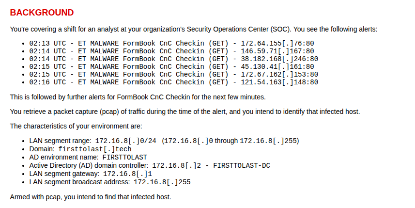

# FormBook / XLoader : identifier un poste infecté à partir d'alertes IDS

**Exercice :** [Malware-Traffic-Analysis.net, 2026-08-09 « First to Last »](https://www.malware-traffic-analysis.net/2026/08/09/index.html)

**Outils :** Wireshark, CyberChef, VirusTotal

## Contexte

L'IDS remonte des alertes `ET MALWARE FormBook CnC Checkin (GET)` vers plusieurs IP externes, à partir de 02:13 UTC (Attention: Mes captures Wireshark affichent l'heure locale (UTC+2)).

ATTENTION: L'énoncé indique que le contrôleur de domaine est 172.16.8[.]2, mais dans la capture de trafic, c'est 172.16.8[.]8 qui répond aux requêtes SMB,DNS... 

## Poste infecté

### Quelle est l'adresse IP du poste infecté ?

**Réponse :** 172.16.8[.]49. L'idée est de partir des IP issus de l'alerte pour identifier l'adresse IP du poste infecté. 

Filtre : `ip.addr == 146.59.71.167 && http.request`

### Quelle est son adresse MAC ?

**Réponse :** 00:12:f0:28:d4:34, il suffit de regarder la couche Ethernet d'un paquet émis par le poste. 

Filtre : `ip.src == 172.16.8.49`

### Quel est son nom d'hôte ?

**Réponse :** DESKTOP-5NLV63K, Le nom du poste peut se trouver dans l'enregistrement NetBIOS du poste ou une requête DHCP. 

Filtre : `ip.addr == 172.16.8.49 && nbns`

### Quel est le compte utilisateur ?

**Réponse :** rvance, le nom du compte peut être trouver dans les échanges Kerberos avec le contrôleur de domaine. 

Filtre : `ip.addr == 172.16.8.49 && kerberos.CNameString`

### Quel est le nom complet de l'utilisateur ?

**Réponse :** Raymond Vance, dans la réponse SAMR `QueryUserInfo` du contrôleur de domaine. 

Filtre : `ip.addr == 172.16.8.49 && samr`

## Comportement du malware

- **Vecteur d'infection non visible** : la capture commence à 02:07. Jusqu'à 02:13, on ne voit que du trafic légitime. La capture ne montre uniquement la phase Commande and Control de l'attaque.
- **Rotation de domaines** : à partir de 02:13, le poste contacte 16 domaines l'un après l'autre. 14 d'entre eux reçoivent 7 requêtes POST puis 1 GET (`/xxxx/?2kn1=...`)
- **Domaines leurres** : la liste commence avec un vrai site (www.independent[.]ie, un journal irlandais légitime). Le C2 fait tourner des URL leurres qui se resolve en erreurs (501,404,500..). Seule l'URL www.taibeinan[.]cc, se traduit par un « 200 OK » mais la page renvoyé est un 404. Au final, le vrai C2 n'est pas identifiable sur la capture.
- **Données chiffrées** : les données sont en Base64. Une fois décodées, leur entropie est de 7,93 bits/octet (le maximum est 8) : elles sont chiffrées et illisibles.

Domaines contactés (hors leurre) : grinswakebthu[.]info, taibeinan[.]cc, legenda-sochi[.]com, titanium303[.]com, 21207628[.]shop, vjscloudjsns[.]beer, kentmediallc[.]com, earthframe[.]site, p3x63q[.]garden, z61gqw[.]beer, www-bet456[.]co, moxom[.]online, thvwzs[.]com, devinnovationhab[.]team, amlgames[.]site

## Recommandations

- Isoler DESKTOP-5NLV63K et le réinstaller.
- Réinitialiser les mots de passe de rvance, ainsi que ceux enregistrés sur le poste : FormBook vole les identifiants.
- Bloquer les domaines ci-dessus sur le proxy et le DNS.

## Ce que j'ai appris

- Partir de l'IP de l'alerte donne le poste infecté en un filtre. Et il faut vérifier l'énoncé : le contrôleur de domaine annoncé n'était pas le bon.
- Quand une information n'est pas là où on l'attend (le nom complet n'était pas dans LDAP), chercher une donnée connue (le login) dans les octets des paquets permet de trouver le bon protocole (SAMR).
- Un code « 200 OK » ne suffit pas : il faut lire le contenu de la réponse.
