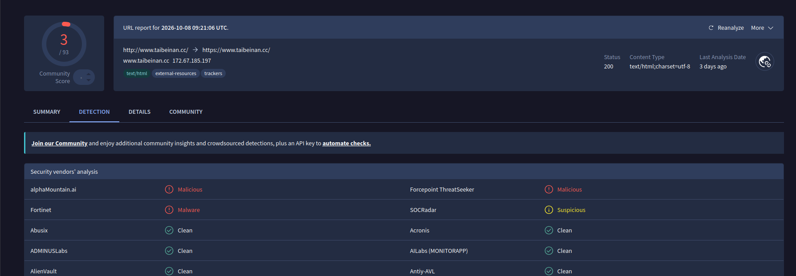

# FormBook / XLoader : identification d'un poste infecté à partir d'alertes IDS

| | |
| --- | --- |
| **Date de l'analyse** | 2026-10-11 |
| **Source** | [Malware-Traffic-Analysis.net, exercice du 2026-08-09 « First to Last »](https://www.malware-traffic-analysis.net/2026/08/09/index.html) |
| **Outils** | Wireshark, CyberChef, VirusTotal, ThreatFox, URLhaus |
| **Verdict** | Vrai positif : poste infecté par FormBook, vraisemblablement sa variante XLoader |
| **Sévérité** | Élevée (infostealer actif sur un poste membre du domaine) |

> Environnement d'exercice public. Les indicateurs (IP, domaines, URL) sont neutralisés (`[.]`) pour éviter tout clic accidentel.
> Les heures du rapport sont en UTC. Les captures d'écran Wireshark affichent l'heure locale de mon poste (CEST, UTC+2) : 04:14 à l'écran correspond à 02:14 UTC.

## 1. Résumé

Des alertes IDS signalent des communications FormBook à partir de 02:13 UTC. L'analyse de la capture réseau identifie le poste compromis : **DESKTOP-5NLV63K** (172.16.8[.]49), utilisé par **Raymond Vance** (compte `rvance`). Dès 02:13, ce poste contacte en boucle une quinzaine de domaines selon un schéma typique de FormBook/XLoader et envoie des données chiffrées, vraisemblablement des informations volées. Le vecteur d'infection n'est pas visible dans la capture. Le poste doit être isolé, et les identifiants de l'utilisateur considérés comme compromis.

## 2. Contexte et alerte de départ

Alertes reçues (Emerging Threats, signature `ET MALWARE FormBook CnC Checkin (GET)`) :

| Heure (UTC) | Destination |
| --- | --- |
| 02:13 | 172.64.155[.]76:80 |
| 02:14 | 146.59.71[.]167:80 |
| 02:14 | 38.182.168[.]246:80 |
| 02:15 | 45.130.41[.]161:80 |
| 02:15 | 172.67.162[.]153:80 |
| 02:16 | 121.54.163[.]148:80 |

Puis d'autres alertes du même type pendant plusieurs minutes.

Périmètre : réseau 172.16.8[.]0/24, domaine Active Directory `firsttolast[.]tech`, passerelle 172.16.8[.]1.

Écart relevé : l'énoncé indique le contrôleur de domaine en 172.16.8[.]2, mais dans la capture, c'est **172.16.8[.]8** qui répond aux requêtes DNS, Kerberos, LDAP et SMB. Le corrigé de l'exercice confirme 172.16.8[.]8. J'ai donc travaillé avec l'adresse observée dans le trafic.

## 3. Identification du poste compromis

| Élément | Valeur | Méthode |
| --- | --- | --- |
| Adresse IP | 172.16.8[.]49 | source des requêtes HTTP vers les IP de l'alerte : `ip.addr == 146.59.71.167 && http.request` |
| Adresse MAC | 00:12:f0:28:d4:34 (Intel) | en-tête Ethernet d'un paquet émis : `ip.src == 172.16.8.49` |
| Nom d'hôte | DESKTOP-5NLV63K | enregistrement NetBIOS : `ip.addr == 172.16.8.49 && (dhcp \|\| nbns)` |
| Compte utilisateur | rvance | Kerberos : `ip.addr == 172.16.8.49 && kerberos.CNameString` |
| Nom complet | Raymond Vance | réponse SAMR `QueryUserInfo` : `ip.addr == 172.16.8.49 && samr` |

La capture contient un seul autre poste client (172.16.8[.]53). Il n'a contacté aucun des serveurs de l'alerte.

La réponse SAMR indique aussi la dernière ouverture de session du compte : 02:08:26 UTC, soit cinq minutes avant la première activité malveillante.

## 4. Investigation

### 4.1 Point de départ : l'alerte

Je suis parti de l'IP de la deuxième alerte et j'ai cherché quel hôte interne lui envoyait des requêtes HTTP. Toutes viennent de 172.16.8[.]49.

### 4.2 Vecteur d'infection initial : non observable

- La capture commence à **02:07:32**. Le poste ouvre sa session sur le domaine vers 02:08.
- Entre 02:08 et 02:12:47, le trafic ne contient que des services Windows et Microsoft (télémétrie, MSN, Bing, Office, Windows Update). J'ai vérifié les domaines inhabituels sur VirusTotal : tous sont légitimes.
- La première requête malveillante part à **02:13:23**, sans téléchargement suspect avant elle.

Conclusion : le malware était déjà présent sur le poste au début de la capture, ou il est arrivé par un canal non réseau. Le vecteur initial ne peut pas être déterminé à partir de ce pcap ; il faudrait les journaux de messagerie ou de l'EDR du poste.

### 4.3 Communication avec le C2

Filtre : `ip.src == 172.16.8.49 && http.request`

**Schéma de rotation.** Le poste contacte une série de domaines, environ un toutes les 20 à 25 secondes. Pour chacun : 7 requêtes POST, puis 1 GET, toujours sur un chemin propre au domaine (`/lqjm/`, `/irpw/`…). Les GET portent un paramètre `2kn1=` suivi de données encodées.

| Premier contact (UTC) | Domaine | IP | Réponse HTTP |
| --- | --- | --- | --- |
| 02:13:23 | www.independent[.]ie | 172.64.155[.]76 | 301 |
| 02:14:07 | www.grinswakebthu[.]info | 146.59.71[.]167 | 404 |
| 02:14:31 | www.taibeinan[.]cc | 38.182.168[.]246 | 200 / 500 / 502 / 404 |
| 02:15:03 | www.legenda-sochi[.]com | 45.130.41[.]161 | 404 |
| 02:15:28 | www.titanium303[.]com | 172.67.162[.]153 | 404 |
| 02:15:52 | www.21207628[.]shop | 121.54.163[.]148 | 404 |
| 02:16:17 | www.vjscloudjsns[.]beer | (aucune) | NXDOMAIN, domaine inexistant |
| 02:16:29 | www.kentmediallc[.]com | 199.192.27[.]50 | 404 |
| 02:16:54 | www.earthframe[.]site | 66.29.149[.]91 | 404 |
| 02:17:19 | www.p3x63q[.]garden | 183.90.186[.]205 | 404 |
| 02:17:49 | www.z61gqw[.]beer | 156.247.51[.]39 | 403 |
| 02:18:14 | www.www-bet456[.]co | 172.67.219[.]130 | 404 |
| 02:18:37 | www.moxom[.]online | 81.2.196[.]19 | 404 |
| 02:19:01 | www.thvwzs[.]com | 104.21.76[.]210 | 404 |
| 02:19:25 | www.devinnovationhab[.]team | 104.21.42[.]23 | 404 |
| 02:19:48 | www.amlgames[.]site | 89.110.89[.]25 | 404 |

Le cycle complet dure 7 minutes (02:13 à 02:20). À 02:20:19, un second cycle commence (independent[.]ie, grinswakebthu[.]info, taibeinan[.]cc), puis la capture s'arrête à 02:21:32.

**Domaines leurres.** www.independent[.]ie est le site d'un vrai quotidien irlandais. Il reçoit pourtant des requêtes au format FormBook (même chemin aléatoire, même paramètre `2kn1=`), et l'IDS l'a signalé. Ce n'est pas un test de connectivité, qui ferait une simple requête vers une page d'accueil et ne serait pas répété à chaque cycle. C'est un mécanisme connu de FormBook et de XLoader : le malware embarque une liste de domaines leurres, légitimes ou non, et les contacte de la même façon que le vrai C2, pour noyer celui-ci dans le bruit et compliquer le blocage.

**Le vrai C2 n'est pas identifiable dans la capture.** Une première lecture des codes de réponse désignait www.taibeinan[.]cc, le seul serveur à répondre `200 OK`. Le contenu de ces réponses infirme cette piste : le corps est `{"code":404,"msg":"404 not found","data":{}}`. C'est un « faux 200 » renvoyé par la plateforme d'hébergement (en-tête `Server: Xcdn`), et non une réponse du C2. Aucun serveur ne répond donc de façon distinctive. Le vrai C2 peut être l'un de ces domaines, temporairement inactif, ou ne pas apparaître dans la capture.

**Données envoyées.** Chaque domaine reçoit exactement la même série de 7 POST, de tailles identiques d'un domaine à l'autre : 909, 3 225, 2 305, 69 101, 69 181, 69 165 et 69 201 octets, soit environ 210 Ko par domaine. Le malware envoie donc les mêmes données à tous les domaines de la liste, ce qui est cohérent avec le mécanisme de leurres : le vrai C2 les reçoit quel qu'il soit. Les quatre envois d'environ 69 Ko correspondent à un volume important ; ce pourrait être des captures d'écran ou des données de navigateur, mais c'est une hypothèse, impossible à vérifier sans déchiffrer. Ces corps de POST et le paramètre des GET sont encodés en Base64. Après décodage, l'entropie de Shannon mesurée avec CyberChef est de **7,93 bits/octet**, le maximum théorique étant 8 : les données sont chiffrées. Un texte en clair se situe autour de 4 à 5 bits/octet. FormBook chiffre ses échanges en RC4 ; le contenu n'est pas lisible sans la clé du malware.

![Requête POST vers www.taibeinan[.]cc](img/07-c2-post.png)

**User-Agent anormal.** Toutes les requêtes C2 annoncent `Mozilla/5.0 (Windows NT 6.2; rv:39.0) Gecko/20100101 Firefox/39.0`, soit Firefox 39 (2015) sur Windows 8. C'est incohérent avec un poste Windows 10/11 récent, et cela fait un bon indicateur de détection.

**Threat intelligence** (consultée le 2026-10-11) : www.taibeinan[.]cc est absent de ThreatFox et d'URLhaus, et obtient 3/93 sur VirusTotal (alphaMountain.ai, Forcepoint, Fortinet). Le domaine pointe aujourd'hui vers une autre IP (172.67.185[.]197) que dans la capture. Cette faible couverture est courante pour des domaines FormBook/XLoader, qui changent très vite.

### 4.4 Éléments écartés

- **02:18:31, GET vers 173.46.81[.]201** (`/c/msdownload/update/software/defu/…/am_delta_patch_….exe`) : il tombe au milieu de la rotation, mais c'est une mise à jour des signatures Microsoft Defender servie par le CDN de Microsoft. Légitime.
- **02:14:30, connexion IMAPS vers imap.gmail[.]com** : elle a lieu en même temps que le démarrage des services Office (officeclient.microsoft.com). C'est vraisemblablement le client de messagerie de l'utilisateur, mais c'est à vérifier sur le poste : un compte de messagerie personnel est aussi une cible de l'infostealer.

## 5. Chronologie (UTC)

| Heure | Événement | Source |
| --- | --- | --- |
| 02:07:32 | Début de la capture | pcap |
| 02:08:12 | Le poste localise le contrôleur de domaine (DNS SRV `_ldap`, `_kerberos`) | DNS |
| 02:08:26 | Ouverture de session du compte `rvance` | SAMR (Last Logon) |
| 02:08 à 02:12 | Trafic Windows et Microsoft uniquement | DNS, TLS |
| 02:13:23 | Première requête FormBook (www.independent[.]ie, leurre) | HTTP |
| 02:14:07 | Début de la rotation sur les domaines C2 | HTTP |
| 02:16:17 | Domaine inexistant (NXDOMAIN), ignoré par le malware | DNS |
| 02:18:31 | Mise à jour Defender (légitime) | HTTP |
| 02:20:19 | Début d'un second cycle de rotation | HTTP |
| 02:21:32 | Fin de la capture | pcap |

## 6. Indicateurs de compromission (IOC)

| Type | Valeur | Contexte |
| --- | --- | --- |
| User-Agent | `Mozilla/5.0 (Windows NT 6.2; rv:39.0) Gecko/20100101 Firefox/39.0` | toutes les requêtes C2 |
| Motif d'URL | `POST /<4 caractères>/` puis `GET /<4 caractères>/?2kn1=<Base64>` | FormBook / XLoader |
| Domaine | www.grinswakebthu[.]info | 146.59.71[.]167 |
| Domaine | www.taibeinan[.]cc | 38.182.168[.]246 |
| Domaine | www.legenda-sochi[.]com | 45.130.41[.]161 |
| Domaine | www.titanium303[.]com | 172.67.162[.]153 |
| Domaine | www.21207628[.]shop | 121.54.163[.]148 |
| Domaine | www.vjscloudjsns[.]beer | non résolu |
| Domaine | www.kentmediallc[.]com | 199.192.27[.]50 |
| Domaine | www.earthframe[.]site | 66.29.149[.]91 |
| Domaine | www.p3x63q[.]garden | 183.90.186[.]205 |
| Domaine | www.z61gqw[.]beer | 156.247.51[.]39 |
| Domaine | www.www-bet456[.]co | 172.67.219[.]130 |
| Domaine | www.moxom[.]online | 81.2.196[.]19 |
| Domaine | www.thvwzs[.]com | 104.21.76[.]210 |
| Domaine | www.devinnovationhab[.]team | 104.21.42[.]23 |
| Domaine | www.amlgames[.]site | 89.110.89[.]25 |

www.independent[.]ie est volontairement exclu : c'est un site légitime utilisé comme leurre, et le bloquer n'aurait aucun intérêt. Plusieurs IP appartiennent à des CDN partagés (Cloudflare : 104.21.x, 172.67.x) ; il faut bloquer les domaines plutôt que ces IP.

## 7. Correspondance MITRE ATT&CK

| Tactique | Technique | ID | Observation |
| --- | --- | --- | --- |
| Command and Control | Application Layer Protocol : Web Protocols | T1071.001 | C2 en HTTP sur le port 80 |
| Command and Control | Data Encoding : Standard Encoding | T1132.001 | Base64 dans le corps des POST et le paramètre `2kn1` |
| Command and Control | Encrypted Channel : Symmetric Cryptography | T1573.001 | entropie de 7,93 bits/octet ; RC4 documenté pour FormBook |
| Exfiltration | Exfiltration Over C2 Channel | T1041 | 7 POST chiffrés (environ 210 Ko) répétés vers chaque domaine |
| Collection | Input Capture : Keylogging / Credentials from Web Browsers | T1056.001 / T1555.003 | capacités documentées de FormBook, **non observables** dans le pcap |

## 8. Recommandations

**Immédiat (confinement)**
- Isoler DESKTOP-5NLV63K du réseau (isolation EDR ou port réseau).
- Bloquer les domaines de la section 6 sur le proxy et le DNS.

**Court terme (éradication et remédiation)**
- Considérer comme compromis tous les identifiants saisis ou enregistrés sur le poste : compte de domaine `rvance`, mots de passe enregistrés dans les navigateurs, messagerie (y compris le compte Gmail observé). Les réinitialiser depuis un poste sain.
- Réinstaller le poste à partir d'une image de référence, plutôt que de le nettoyer.
- Retrouver le vecteur initial à partir de l'EDR et de la messagerie : FormBook/XLoader arrive généralement par une pièce jointe d'e-mail.
- Rechercher le même schéma (User-Agent, motif d'URL) sur le reste du parc. Dans cette capture, 172.16.8[.]53 n'est pas concerné.

**Prévention**
- Alerter sur les User-Agent de navigateurs obsolètes en sortie du proxy.
- Imposer le passage par un proxy authentifié pour le HTTP sortant : un malware qui contourne le proxy se repère immédiatement.
- Sensibiliser les utilisateurs aux pièces jointes malveillantes.

## 9. Ce que j'ai appris

- **Partir de l'alerte.** Chercher qui parle à l'IP signalée donne le poste infecté en un filtre. J'ai douté de ma réponse en cours de route alors qu'elle était juste : la vérifier par un second moyen (cohérence avec le plan d'adressage, statistiques de conversation) évite de tourner en rond.
- **Ne pas faire une confiance aveugle à l'énoncé.** Le contrôleur de domaine annoncé (172.16.8[.]2) n'était pas celui du trafic (172.16.8[.]8). Mes premiers filtres LDAP ne renvoyaient que des requêtes « rootDSE » sans intérêt.
- **Pivoter sur une donnée connue.** Le nom complet n'était pas dans LDAP mais dans une réponse SAMR. Je l'ai trouvé en cherchant le login `rvance` dans les octets des paquets, en version UTF-16 (`frame matches "(?i)r.v.a.n.c.e"`) et en excluant Kerberos.
- **Lire le contenu, pas seulement le code de réponse.** Un « 200 OK » m'a d'abord fait désigner le vrai C2. Le corps de la réponse montrait un 404 déguisé.
- **Un artefact de décodage n'est pas un indice.** Des données chiffrées décodées en UTF-16 donnent des caractères chinois. L'entropie le confirme : cela ne dit rien de l'origine de l'attaquant.
- **Dire ce que la capture ne montre pas.** Le vecteur initial et le vrai C2 ne sont pas observables ici : c'est une conclusion en soi, pas un échec.
